<div align="center">
  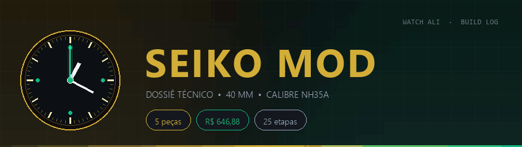
</div>

<h1 align="center">Seiko Mod 40 mm · Build Log · Projeto-teste de agentes de IA de baixo custo e CLI's OpenSource :)</h1>

<p align="center">
  <strong>Dossiê técnico, orçamento dinâmico e controle de bancada para uma montagem com calibre SII NH35A.</strong><br />
  Uma interface local, offline-first e sem framework — feita para acompanhar cada peça, parafuso e centavo do projeto.
</p>

<div align="center">

<table align="center" border="0" cellpadding="7" cellspacing="0">
  <tr>
    <td align="center" valign="middle">
      
    </td>
    <td align="center" valign="middle">
      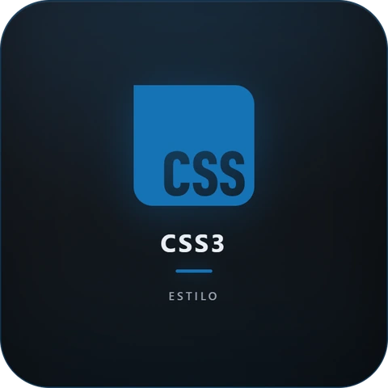
    </td>
  </tr>
  <tr>
    <td align="center" valign="middle">
      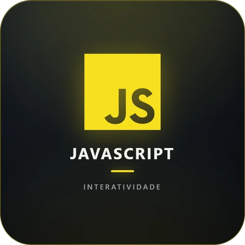
    </td>
    <td align="center" valign="middle">
      
    </td>
  </tr>
  <tr>
    <td align="center" valign="middle">
      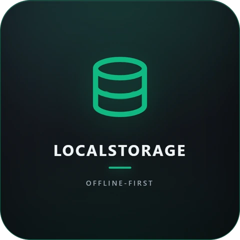
    </td>
    <td align="center" valign="middle">
      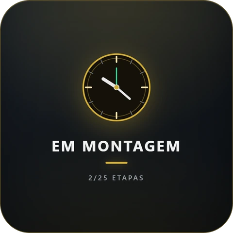
    </td>
  </tr>
</table>

</div>

<p align="center">
  <a href="#-demo"><strong>Demo</strong></a> ·
  <a href="#-como-rodar"><strong>Como rodar</strong></a> ·
  <a href="#-funcionalidades"><strong>Funcionalidades</strong></a> ·
  <a href="#-o-build"><strong>O build</strong></a> ·
  <a href="#-estrutura"><strong>Estrutura</strong></a>
</p>

---

## 🎬 Demo

<div align="center">
  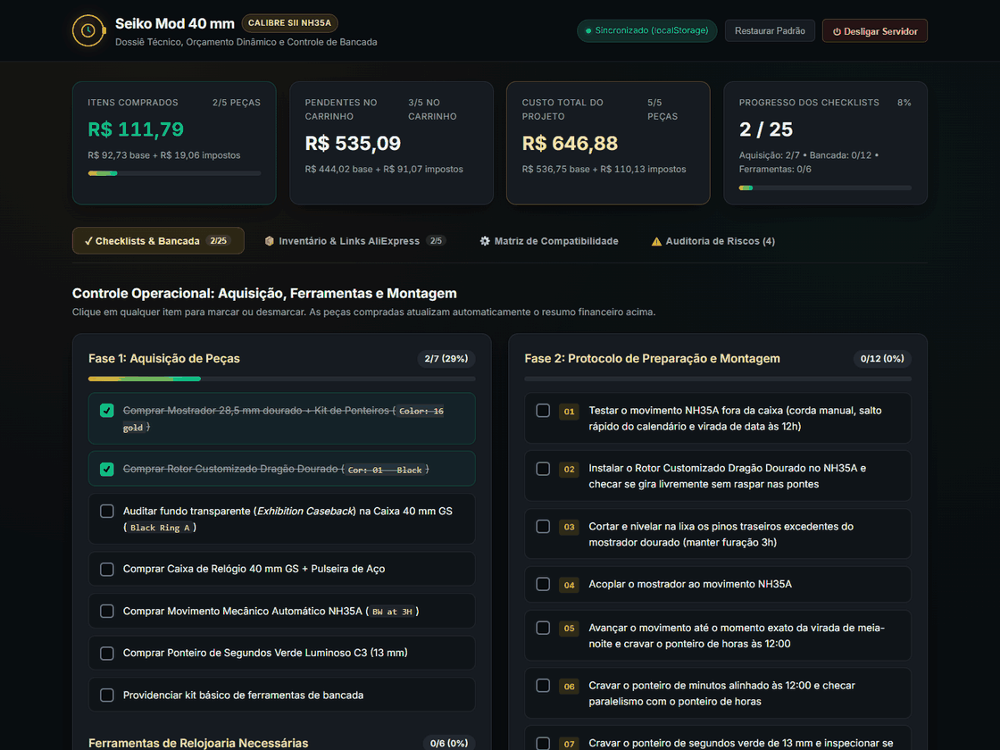
  <br />
  <sub>Navegação real pelas quatro áreas do dashboard — capturada direto da aplicação.</sub>
</div>

> **TL;DR:** um painel estático servido por um micro-servidor Python. Todo o progresso fica no `localStorage` do navegador. Sem banco de dados, sem login, sem build step.

---

## ✨ Funcionalidades

| | Recurso | O que faz |
| :---: | :--- | :--- |
| 📊 | **KPIs em tempo real** | Recalcula peças compradas, pendentes, impostos, custo total e progresso dos checklists a cada clique. |
| ✅ | **Checklists bidirecionais** | Marcar uma peça como comprada sincroniza o checklist de aquisição — e vice-versa. Ferramentas concluídas liberam a etapa correspondente. |
| 📦 | **Inventário com links diretos** | Variantes, preço base, impostos, total e observações técnicas de cada peça, com atalho para o anúncio no AliExpress. |
| ⚙️ | **Matriz de compatibilidade** | Validação dimensional do NH35A + mostrador de 28,5 mm + caixa de 40 mm, com diagrama radial em SVG. |
| ⚠️ | **Auditoria de riscos** | Quatro pontos críticos de bancada: caseback, dial feet, segundeiro de 13 mm e corte da tige. |
| 💾 | **Persistência local** | Estado salvo automaticamente em `localStorage`; botão para restaurar o dossiê original. |
| ⏻ | **Servidor com um clique** | `servidor.bat` liga/desliga o servidor local e abre o navegador. Botão de shutdown também disponível na interface. |
| 📱 | **Responsivo e dark-first** | Layout em grid, tipografia Inter e paleta preto/dourado/lume verde — confortável na bancada e no celular. |

---

## 🚀 Como rodar

### Opção 1 — Windows, um clique

Dê um duplo clique em **`servidor.bat`**.

Ele alterna o estado do servidor:

- **Desligado →** inicia em background, grava o PID e abre `http://localhost:8080`.
- **Ligado →** encerra o processo com segurança.

### Opção 2 — Terminal

```bash
# liga ou desliga (comportamento do .bat)
python server.py --toggle

# controle explícito
python server.py --start     # inicia em background + abre o navegador
python server.py --stop      # encerra o servidor
python server.py --status    # imprime ONLINE ou OFFLINE
python server.py --serve     # roda em foreground (Ctrl+C para parar)
```

> Requer **Python 3.10+**. Nenhuma dependência externa é necessária — só a biblioteca padrão.

### Opção 3 — Abrir direto

Também funciona abrir `index.html` no navegador. A interface e o `localStorage` operam normalmente; apenas o botão **Desligar Servidor** não tem efeito, pois não há servidor para encerrar.

---

## 🖼️ Telas

<div align="center">

| Inventário & Links | Matriz de Compatibilidade |
| :---: | :---: |
| 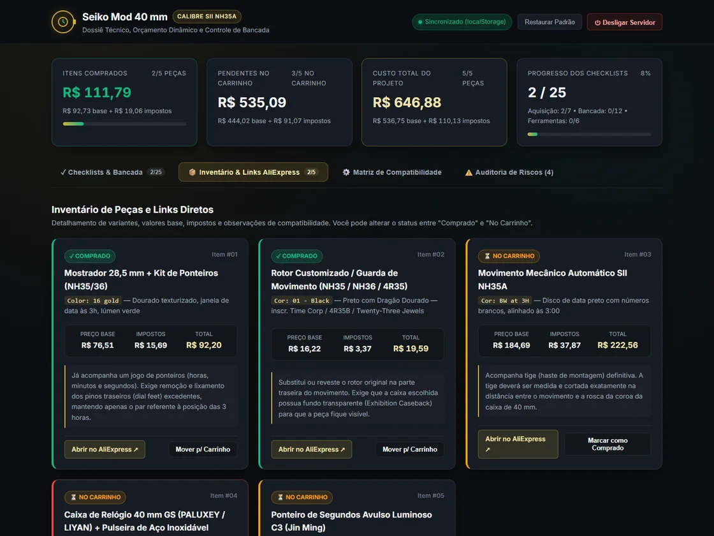 | 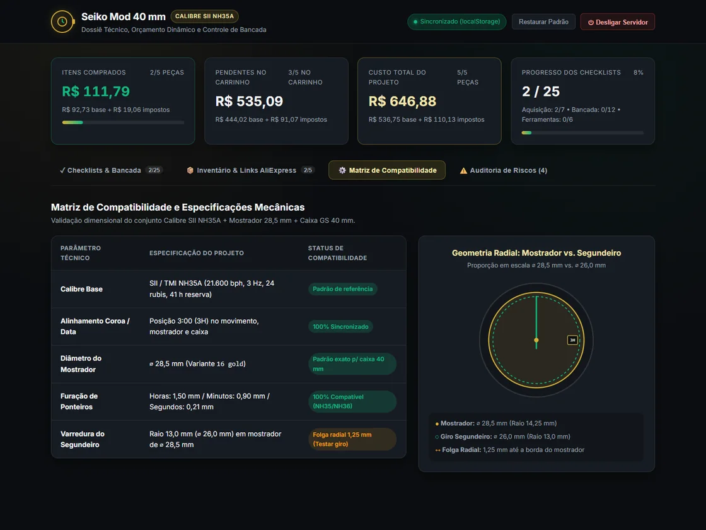 |
| <sub>Status, variantes, preços e notas por peça.</sub> | <sub>Dimensional e geometria do segundeiro em SVG.</sub> |

</div>

<details>
  <summary><strong>Ver também: checklists e auditoria de riscos</strong></summary>
  <br />
  <div align="center">

| Checklists & Bancada | Auditoria de Riscos |
| :---: | :---: |
| 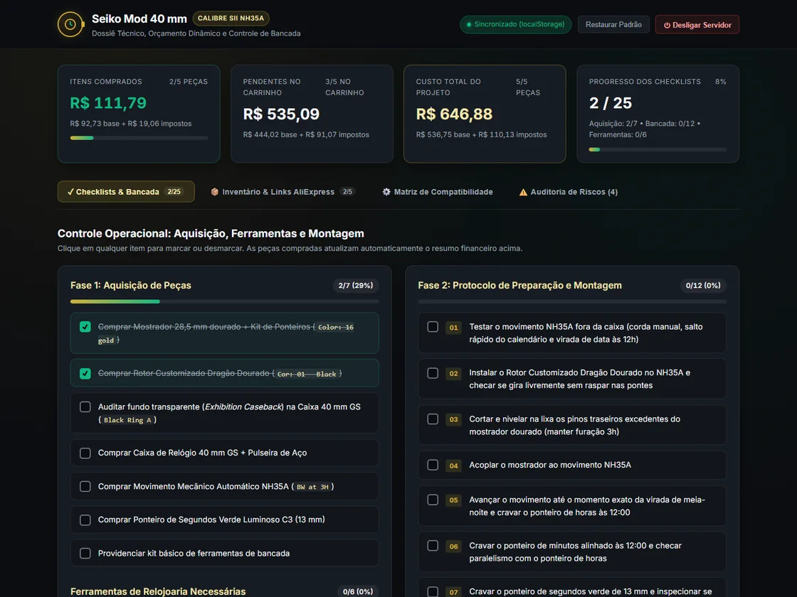 | 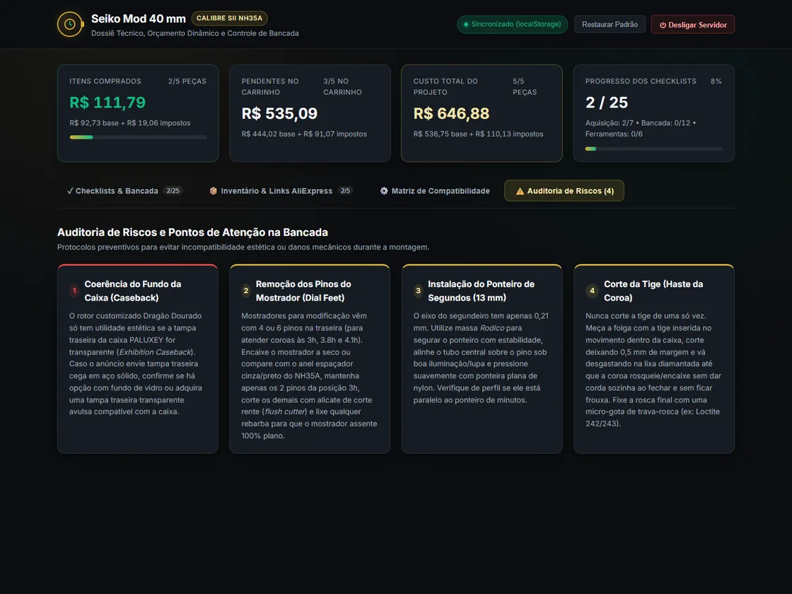 |
| <sub>Aquisição, ferramentas e protocolo de montagem.</sub> | <sub>Quatro alertas críticos antes de fechar a caixa.</sub> |

  </div>
</details>

---

## 🧠 Como funciona

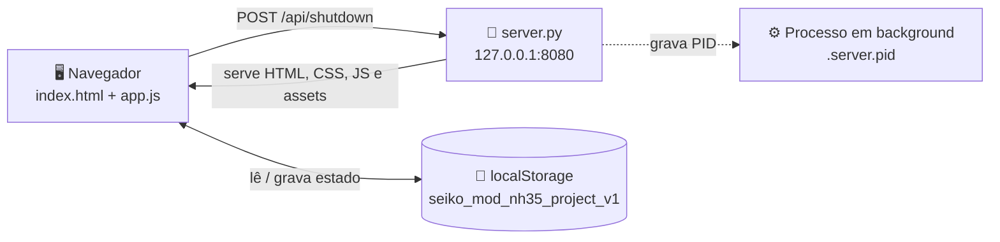

O front-end é 100% estático. O Python não guarda dados: ele apenas entrega os arquivos, responde ao endpoint de status e encerra o processo quando solicitado.

### API local

| Método | Rota | Resposta / efeito |
| :---: | :--- | :--- |
| `GET` | `/api/status` | `{"status": "online", "port": 8080}` |
| `POST` | `/api/shutdown` | `{"status": "shutting_down"}` e encerra o servidor |
| `GET` | `/*` | Arquivos estáticos do projeto (`index.html`, `styles.css`, `app.js`, `assets/`) |

O servidor usa `ThreadingHTTPServer` em `127.0.0.1`, com `Cache-Control: no-store` para evitar conteúdo velho durante o desenvolvimento.

---

## 💾 Persistência

- **Chave:** `seiko_mod_nh35_project_v1`
- **Onde:** `localStorage` do navegador
- **O que salva:** peças, status de compra, checklists de aquisição, montagem e ferramentas
- **Reset:** botão **Restaurar Padrão** no cabeçalho (pede confirmação)

Como os dados vivem no navegador, limpar os dados do site ou usar outro navegador/perfil começa do zero. O servidor pode ser desligado sem perda de progresso.

---

## ⌚ O build

> **Status atual:** 2 de 5 peças compradas · **R$ 111,79** investidos de **R$ 646,88** · **2/25** etapas concluídas.

| # | Peça | Variante | Total | Status |
| :---: | :--- | :--- | ---: | :---: |
| 01 | [Mostrador 28,5 mm + kit de ponteiros](https://pt.aliexpress.com/item/1005011821795123.html) | `Color: 16 gold` | R$ 92,20 | ✅ Comprado |
| 02 | [Rotor customizado Dragão Dourado](https://pt.aliexpress.com/item/1005006305556868.html) | `Cor: 01 - Black` | R$ 19,59 | ✅ Comprado |
| 03 | [Movimento SII NH35A](https://pt.aliexpress.com/item/1005013423810577.html) | `BW at 3H` | R$ 222,56 | 🛒 No carrinho |
| 04 | [Caixa GS 40 mm + pulseira de aço](https://pt.aliexpress.com/item/1005012866787629.html) | `Black Ring A` | R$ 297,53 | 🛒 No carrinho |
| 05 | [Ponteiro de segundos C3 13 mm](https://pt.aliexpress.com/item/1005012604177401.html) | `Green` | R$ 15,00 | 🛒 No carrinho |

| Resumo financeiro | Valor |
| :--- | ---: |
| Peças compradas | R$ 111,79 |
| Pendentes no carrinho | R$ 535,09 |
| **Custo total das peças** | **R$ 646,88** |
| Base + impostos | R$ 536,75 + R$ 110,13 |

### Compatibilidade em uma linha

NH35A (21.600 bph · 3 Hz · 24 rubis · 41 h) + mostrador de **⌀ 28,5 mm** + caixa de **40 mm** + segundeiro de **13 mm** (varredura de ⌀ 26,0 mm).

> ⚠️ **Ponto crítico:** confirme se a variante da caixa tem fundo de vidro (*exhibition caseback*) antes de comprar. O rotor de dragão só aparece com a tampa transparente.

Relatório completo, riscos, ferramentas e protocolo passo a passo: [`DOSSIE_PROJETO.md`](DOSSIE_PROJETO.md).

---

## 📁 Estrutura

```text
Watch_ali/
├─ index.html          # shell da aplicação e conteúdo das 4 abas
├─ styles.css          # design system dark/gold/lume, grid e responsividade
├─ app.js              # estado, localStorage, KPIs, checklists e renderização
├─ server.py           # servidor local + endpoints de status/shutdown
├─ servidor.bat        # atalho Windows para ligar/desligar
├─ Seiko Mod.lnk       # atalho de inicialização
├─ icone_seiko.ico     # favicon
├─ DOSSIE_PROJETO.md   # dossiê técnico completo
├─ assets/
│  ├─ banner.gif       # banner animado do README
│  ├─ demo.gif         # demo navegando pelas abas
│  ├─ badges/          # cards 1:1 da stack
│  └─ *.webp           # screenshots otimizados
└─ README.md
```

### Stack

- **Front-end:** HTML semântico, CSS puro (custom properties, grid, `backdrop-filter`) e JavaScript vanilla.
- **Estado:** objeto único em memória espelhado no `localStorage`.
- **Back-end:** Python `http.server` + `ThreadingHTTPServer`.
- **Sem dependências:** nenhum `npm install`, bundler ou framework.

---

## 🗺️ Roadmap

- [x] Dashboard com KPIs financeiros e de progresso
- [x] Inventário com links e notas técnicas
- [x] Checklists bidirecionais com persistência
- [x] Matriz de compatibilidade e diagrama radial
- [x] Auditoria de riscos
- [x] Servidor local com liga/desliga
- [ ] Comprar movimento, caixa e segundeiro
- [ ] Auditar o caseback transparente da caixa
- [ ] Montar, regular e testar o relógio na bancada
- [ ] Registrar o resultado final com fotos

---

## 📝 Notas

- Este é um **projeto pessoal de mod** inspirado no universo Seiko. Não há vínculo, patrocínio ou afiliação com a Seiko Watch Corporation.
- Preços e impostos são valores do momento da compra e podem variar.
- O botão de shutdown encerra apenas o servidor local; o navegador e o progresso permanecem intactos.

<div align="center">
  <br />
  <sub>Feito para a bancada — com paciência, Rodico e uma lupa.</sub><br />
  <sub>⌚ <strong>Seiko Mod 40 mm</strong> · NH35A · Build Log</sub>
</div>
